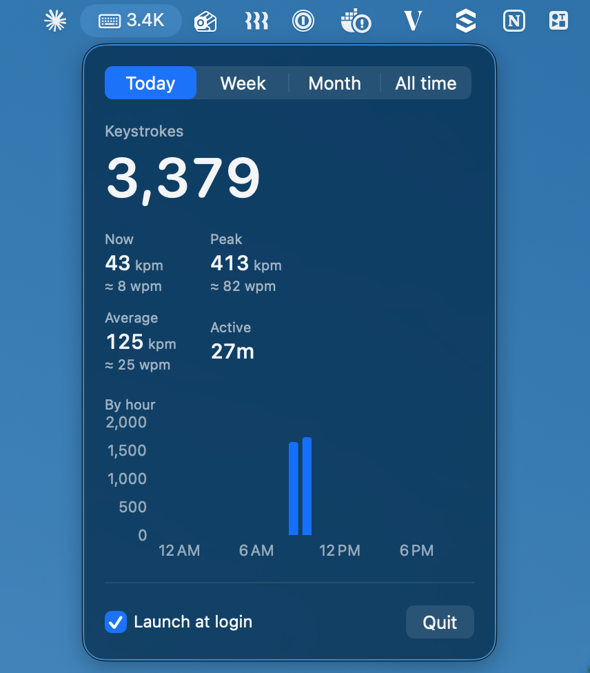

# KeyCount ⌨️

**How much do you actually type?** KeyCount is a tiny, free keystroke counter that lives in your Mac's menu bar. Click it to see your keystrokes, keys per minute, and words per minute for today, this week, this month, or all time.

  



- 🔢 Live keystroke count in the menu bar
- ⚡ Current, peak, and average keys per minute, with words per minute
- 📊 Charts by hour, day, and month
- 🔒 100% local: counts key presses, never records which keys
- 🪶 Native Swift, about 500 lines, no dependencies

## Install

```sh
git clone https://github.com/ethanwfang/macOS-typecount.git
cd macOS-typecount
./install.sh
```

Then click the menu bar icon, press **Open Settings**, and turn on KeyCount under **Input Monitoring**. That's it.

No Xcode or Apple developer account needed. The script builds the app on your Mac and installs it to `/Applications`. If Apple's Command Line Tools are missing, it installs them first; run `./install.sh` again after.

## Privacy

KeyCount only counts how many keys you press per minute. It never sees what you type, and it never touches the network. Your counts stay in `~/Library/Application Support/KeyCount/`. 

## Update or uninstall

```sh
git pull && ./install.sh   # update (macOS asks for Input Monitoring again)
./uninstall.sh             # remove the app and all its data
```

## FAQ

**How is words per minute calculated?** Keys per minute ÷ 5, the standard typing-test definition. Backspace and shortcuts count too, so treat it as an estimate.

**Why does it start counting from zero?** macOS keeps no keystroke history, so KeyCount counts from the moment you install it.

## Contributing

Issues and pull requests are welcome. `swift build` builds it and `swift run KeyCountChecks` runs the checks.

If KeyCount is useful to you, a ⭐ helps other people find it.

## License

[MIT](LICENSE)
